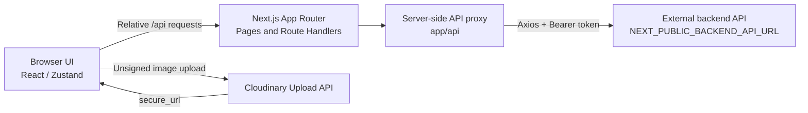

# Petlove

Petlove is a responsive pet discovery and profile web application built with Next.js and React. It provides pages for browsing pet notices and news, discovering partner organizations, registering and signing in, managing favorite notices, editing a user profile, and adding pets.

The application uses Next.js route handlers as a server-side proxy between the browser and a separate backend API. Authentication is stored by the proxy in an HTTP-only access-token cookie, while client-side state is maintained with Zustand.

## Table of contents

- [Main features](#main-features)
- [Technology stack](#technology-stack)
- [Application routes](#application-routes)
- [Architecture](#architecture)
- [Project structure](#project-structure)
- [Getting started](#getting-started)
- [Environment configuration](#environment-configuration)
- [Running the project](#running-the-project)
- [Main implementation details](#main-implementation-details)
- [Testing](#testing)
- [Build and deployment](#build-and-deployment)
- [Known verification requirements](#known-verification-requirements)

## Main features

### Public and account areas

- Browse a paginated list of pet notices.
- Search and filter notices by keyword, category, species, sex, and location.
- Sort notices by popularity or price.
- Open a notice detail modal and contact the notice owner through email or phone.
- Add or remove notices from a personal favorites collection.
- Browse paginated news and search by keyword.
- View a list of partner organizations, including work schedules and contact details.
- Register and sign in with validated forms.
- Sign out and restore the authenticated session on page load.

### Authenticated profile

The `/profile` and `/add-pet` routes are protected by the private route layout.

- View profile information, owned pets, and viewed/favorite notices.
- Edit name, email, phone, and avatar.
- Upload avatars and pet photos directly to Cloudinary.
- Add a pet with title, name, species, birthday, sex, and image URL.
- Remove a pet from the profile.
- Switch between favorite and viewed notice lists.

## Technology stack

| Area | Technology |
| --- | --- |
| Framework | Next.js 16 App Router |
| UI library | React 19 |
| Language | TypeScript 5/6 and strict compiler settings |
| Styling | CSS Modules, global CSS variables, responsive media queries |
| Forms | React Hook Form and Yup |
| Client state | Zustand |
| HTTP client | Fetch API in browser code and Axios in Next.js server route handlers |
| Select controls | react-select |
| Notifications | react-hot-toast |
| Icons | Inline SVG symbol sprite and lucide-react |
| Image uploads | Cloudinary unsigned uploads |
| Testing | Vitest |
| Linting | ESLint 9 with Next.js Core Web Vitals and TypeScript rules |

Package versions are declared in [`package.json`](./package.json). The repository also includes a `package-lock.json`, so npm is the package manager represented by the lockfile.

## Application routes

| Route | Type | Implemented purpose |
| --- | --- | --- |
| `/` | Public | Redirects to `/home` |
| `/home` | Public | Home hero and primary introduction |
| `/notices` | Public | Notice search, filters, pagination, details, and favorites |
| `/news` | Public | News search and pagination |
| `/friends` | Public | Partner organizations and contact information |
| `/login` | Public | Sign-in form |
| `/register` | Public | Registration form |
| `/profile` | Private | User profile, pets, favorite notices, and viewed notices |
| `/add-pet` | Private | Pet creation form |

The `/profile` and `/add-pet` pages share the private layout in [`app/(private)/layout.tsx`](<./app/(private)/layout.tsx>). It checks for `accessToken`, validates the token against the backend, and redirects to `/login` when the cookie is absent or the backend returns `401`.

## Architecture



### Request flow

1. A React component calls a function from [`lib/clientApi.ts`](./lib/clientApi.ts).
2. The function sends a request to a same-origin `/api/...` route.
3. A Next.js route handler reads or sets the HTTP-only `accessToken` cookie.
4. Protected requests add `Authorization: Bearer <token>` to the external backend request.
5. The route handler returns the backend response and normally removes the backend `token` field from JSON.
6. Browser state is updated through local component state or Zustand stores.

The browser-facing API route helpers return typed data and convert unsuccessful responses into JavaScript `Error` instances with backend or fallback messages.

### Authentication state

Authentication is represented by [`lib/store/auth.ts`](./lib/store/auth.ts):

- `user`
- `isAuthenticated`
- `isAuthLoading`
- user updates and favorite synchronization helpers

[`components/Header/Header.tsx`](./components/Header/Header.tsx) restores the session on mount by calling `/api/users/current/full`, then loads favorites.

The access-token cookie:

- is named `accessToken`
- is HTTP-only
- uses `sameSite=lax`
- uses `path=/`
- is marked `secure` when `NODE_ENV === "production"`

### Favorites state

[`lib/store/favoritesStore.ts`](./lib/store/favoritesStore.ts) keeps the IDs of favorite notices separately from the full user object. It loads favorites from the authenticated user, supports add/remove operations, and synchronizes with the auth store after updates.

## Project structure

```text
petlove/
├── app/
│   ├── api/                 # Same-origin Next.js proxy routes
│   │   ├── cities/
│   │   ├── friends/
│   │   ├── news/
│   │   ├── notices/
│   │   └── users/
│   ├── (private)/           # Authentication-protected profile routes
│   ├── friends/
│   ├── home/
│   ├── login/
│   ├── news/
│   ├── notices/
│   ├── register/
│   ├── layout.tsx           # Root layout, metadata, header, font, toaster
│   └── globals.css          # Global reset and design variables
├── components/              # Reusable client/server UI components
├── hooks/                   # Reusable React hooks
├── lib/
│   ├── clientApi.ts         # Browser-facing API functions
│   ├── api.ts               # Auxiliary Axios instance
│   ├── cloudinary.ts        # Image validation and upload
│   └── store/               # Zustand auth and favorites stores
├── public/                  # Local WebP/PNG/SVG assets
├── tests/
│   ├── api/                 # Route-handler tests
│   ├── app/                 # App/layout tests
│   └── lib/                 # Store and utility tests
├── types/                   # Shared TypeScript domain types
├── utils/                   # Shared utility functions
├── .env.example
├── next.config.js
├── next.config.ts
├── vitest.config.ts
├── eslint.config.mjs
├── tsconfig.json
└── package.json
```

### Key directories

| Path | Responsibility |
| --- | --- |
| [`app/`](./app) | Pages, layouts, metadata, styles, and server route handlers |
| [`components/`](./components) | Header, forms, notice/news/friends lists, modals, profile, and reusable UI |
| [`lib/clientApi.ts`](./lib/clientApi.ts) | Browser requests to same-origin Next.js API routes |
| [`app/api/`](./app/api) | Backend proxy and HTTP cookie management |
| [`lib/store/`](./lib/store) | Zustand authentication and favorites state |
| [`types/`](./types) | Shared users, pets, notices, news, and partner types |
| [`public/`](./public) | Responsive image assets and SVG icon sprite |
| [`tests/`](./tests) | Vitest unit and route/layout tests |

## Getting started

### Prerequisites

- Node.js
- npm
- Access to the external backend API used by this project
- A Cloudinary cloud name and unsigned upload preset for image uploads

The exact supported Node.js version is not declared in `package.json` or a version-manager file, so it requires verification for this repository.

### Install

From the repository root:

```bash
npm install
```

Create `.env.local` from the available example, and add the external API variables required by the source code:

```env
NEXT_PUBLIC_BACKEND_API_URL=<external backend API origin>
NEXT_PUBLIC_API_URL=<optional auxiliary API origin used by lib/api.ts>
NEXT_PUBLIC_CLOUDINARY_CLOUD_NAME=<cloudinary cloud name>
NEXT_PUBLIC_CLOUDINARY_UPLOAD_PRESET=<unsigned upload preset>
```

The repository's existing [`.env.example`](./.env.example) documents only the two Cloudinary variables. `NEXT_PUBLIC_BACKEND_API_URL` is used directly by [`app/api/api.ts`](./app/api/api.ts) and must be configured for backend-backed features to work. `NEXT_PUBLIC_API_URL` is referenced by [`lib/api.ts`](./lib/api.ts), but that exported Axios instance is not currently imported elsewhere in the searched source.

## Environment configuration

| Variable | Used in | Required for |
| --- | --- | --- |
| `NEXT_PUBLIC_BACKEND_API_URL` | `app/api/api.ts` | News, friends, notices, cities, authentication, profile, and pet backend requests |
| `NEXT_PUBLIC_CLOUDINARY_CLOUD_NAME` | `lib/cloudinary.ts` | Direct avatar/pet image uploads |
| `NEXT_PUBLIC_CLOUDINARY_UPLOAD_PRESET` | `lib/cloudinary.ts` | Direct avatar/pet image uploads |
| `NEXT_PUBLIC_API_URL` | `lib/api.ts` | Auxiliary Axios instance; no current usage was found outside that file |

Only public variables prefixed with `NEXT_PUBLIC_` are used by the current source. The access token is read in server-side route handlers and stored as an HTTP-only cookie; it is not sent back to normal JSON responses.

Cloudinary behavior:

- Browser-side file validation requires an image MIME type.
- Maximum file size is 10 MB.
- The upload preset must be unsigned.
- Cloudinary must return an HTTPS `secure_url`.

## Running the project

### Development server

```bash
npm run dev
```

The Next.js development server defaults to `http://localhost:3000` when port 3000 is available.

### Production build

```bash
npm run build
npm run start
```

`npm run build` creates the optimized Next.js build. `npm run start` starts the built application with the Next.js production server.

## Main implementation details

### News

The news page loads `/api/news` on mount and on search or pagination actions. The Next route forwards `query`, `page`, and `perPage` to the external backend. The default page size used by the client is 6.

### Notices

The notices page maintains:

- Current page
- Search keyword
- Category
- Species
- Sex
- Location
- Sorting
- Loading/error state

The browser requests six results per page. The Next route translates the sorting value into backend flags:

| UI sort | Backend transformation |
| --- | --- |
| `popular` | `byPopularity=false` |
| `unpopular` | `byPopularity=true` |
| `cheap` | `byPrice=true` |
| `expensive` | `byPrice=false` |

The location filter uses an asynchronous `react-select` control and searches `/api/cities` after at least three characters.

### Notice details and favorites

Notice cards open a modal with details and a five-star popularity display. Authenticated users can add or remove favorites. Favorites are synchronized with both the Zustand favorites store and the auth store's full user object.

### Profile and pets

The profile includes a separate favorites/viewed tab interface. Profile editing and pet creation use React Hook Form with Yup resolvers.

Pet form validation currently expects:

- A title and pet name
- A supported species
- A supported sex
- A `YYYY-MM-DD` birthday
- An image URL ending in a supported image extension

The Cloudinary file upload path can supply the image URL directly; it validates the local file to be an image and no larger than 10 MB.

### Images and responsive assets

The Next.js image configuration enables AVIF and WebP output formats. Remote image hosts are configured for:

- `ftp.goit.study`
- `www.nytimes.com`
- `media4.giphy.com`
- `res.cloudinary.com`

Local responsive assets are stored in `public/`, with separate mobile, tablet, and desktop variants for the main layouts where applicable. `next/image` is used for managed sizing and lazy loading, while some decorative/page imagery uses `<picture>` with explicit `srcSet` values.

### Client and server components

Most interactive pages and components use `"use client"`; the home page itself is server-rendered because it does not require browser state or event handlers. The root layout remains a server layout and includes the interactive Header and toast provider.

## Testing

Run the complete Vitest suite:

```bash
npm run test
```

Run Vitest in watch mode:

```bash
npm run test:watch
```

The test suite covers:

| Area | Test location |
| --- | --- |
| Authentication API routes | `tests/api/auth-routes.test.ts` |
| Notices API route | `tests/api/notices-route.test.ts` |
| News API route | `tests/api/news-route.test.ts` |
| Private route layout | `tests/app/private-layout.test.tsx` |
| Auth Zustand store | `tests/lib/auth-store.test.ts` |
| Favorites Zustand store | `tests/lib/favorites-store.test.ts` |
| Cloudinary helper | `tests/lib/cloudinary.test.ts` |
| News client API | `tests/lib/news-api.test.ts` |

These tests mock the external backend and Next.js APIs where appropriate. There is no separate browser/E2E test configuration in the repository.

## Linting

Run ESLint:

```bash
npm run lint
```

The configuration includes Next.js Core Web Vitals and TypeScript rules. Build output and `next-env.d.ts` are excluded.

## Build and deployment

The project includes standard Next.js build and start scripts:

```bash
npm run build
npm run start
```

For deployment, configure at least:

- `NEXT_PUBLIC_BACKEND_API_URL`
- `NEXT_PUBLIC_CLOUDINARY_CLOUD_NAME`
- `NEXT_PUBLIC_CLOUDINARY_UPLOAD_PRESET`

Set the environment variables in the deployment platform and ensure that the external backend allows requests from the deployed Next.js origin. The cookie is marked secure in production.

No deployment platform configuration, CI workflow, Dockerfile, or infrastructure-as-code file is currently present in the repository. Vercel deployment is therefore not established as a project-specific deployment configuration; it is only the conventional platform supported by Next.js.

## Known verification requirements

The following details could not be established solely from the repository:

- The exact supported Node.js and npm versions.
- The external backend API URL and available hosted environment.
- The required values of `NEXT_PUBLIC_BACKEND_API_URL`.
- The production domain, hosting provider, and deployment pipeline.
- Whether `NEXT_PUBLIC_API_URL` should be configured or whether [`lib/api.ts`](./lib/api.ts) is legacy or auxiliary code.
- Whether `next.config.js` or `next.config.ts` is the intended active Next.js configuration. Both files currently contain image configuration.
- End-to-end browser tests and a live backend integration test.
- Whether all Cloudinary upload preset restrictions are configured in the actual Cloudinary account.
